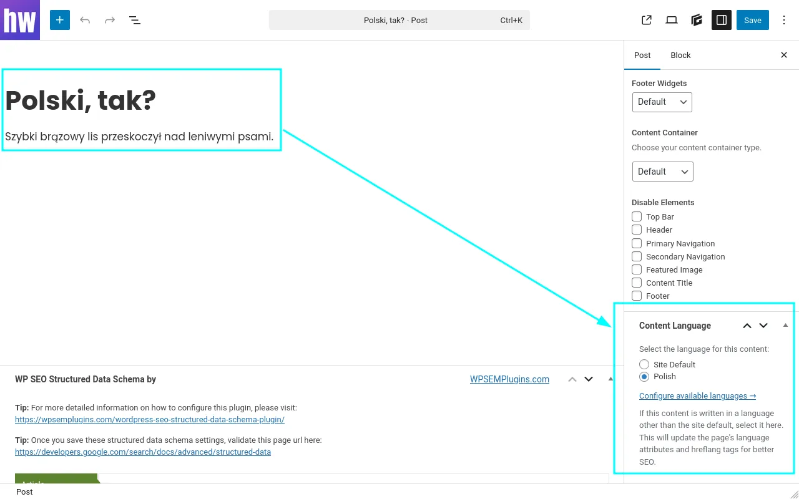

# Quick WP Lang

[](https://github.com/headwalluk/quick-wp-lang/releases/latest)
[](https://www.php.net/)
[](https://wordpress.org/)
[](LICENSE)
[](https://github.com/WordPress/WordPress-Coding-Standards)

Set the language of individual posts, pages and custom post types for SEO, and link translations to their original, without a full multilingual setup.

## What it does

For a site in one language with some content in others — an English (UK) site with a few French pages, say:

- Sets `<html lang>` on each page to the content's language
- Links a translation to its original, so **both** pages list every version in `hreflang` tags, with `x-default` pointing at the original
- Sends a `Content-Language` HTTP header (optional)
- Gets `og:locale` right, and with Yoast SEO, the schema `inLanguage` too
- Leaves canonical URLs, sitemaps and permalinks alone: each version stays indexable at its own URL

It doesn't translate anything or create copies of posts. See [how it works](docs/how-it-works.md).



## Install

### Standard plugin

1. Download `quick-wp-lang.zip` from the [latest release](https://github.com/headwalluk/quick-wp-lang/releases/latest)
2. WordPress admin → Plugins → Add New → Upload Plugin → choose the zip → Install Now → Activate
3. Settings → Content Language → tick the languages you need
4. Edit a post, pick its language in the **Content Language** box and, for a translation, the page it translates

After install, the plugin receives future updates automatically through the bundled GitHub updater.

### Must-use plugin

1. Extract the `quick-wp-lang` folder into `wp-content/mu-plugins/`
2. WordPress doesn't load plugins from subfolders of `mu-plugins/`, so create `wp-content/mu-plugins/quick-wp-lang-loader.php` to load it:

   ```php
   <?php
   require_once __DIR__ . '/quick-wp-lang/quick-wp-lang.php';
   ```

3. Settings → Content Language to configure

WordPress doesn't update must-use plugins, so the bundled updater doesn't apply. Update by replacing the `quick-wp-lang` folder with the one from a newer release.

### Requirements

- WordPress 6.9 or later
- PHP 8.2 or later

## Documentation

Full user and developer documentation lives in [`docs/`](docs/):

- [How it works](docs/how-it-works.md)
- [Configuration](docs/configuration.md)
- [Troubleshooting](docs/troubleshooting.md)
- [Hooks and filters](docs/developers/hooks-and-filters.md) *(for developers)*
- [Extending Quick WP Lang](docs/developers/extending.md) *(for developers)*

## Security disclosures

See [SECURITY.md](SECURITY.md) for the responsible-disclosure process.

## License

GPL v2 or later. See [LICENSE](LICENSE).
